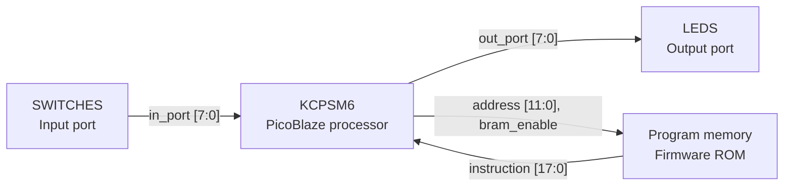

# Practical lecture

## PicoBlaze switch and LED control on Nexys4 DDR

Build a small processor-based system in **Vivado 2022.2**. Each of the 16 switches controls the LED with the same number. The design uses the real **KCPSM6 PicoBlaze processor** and a **1024 x 18-bit program ROM** implemented in one FPGA Block RAM. The completed design was programmed onto a Nexys4 DDR, and its operation was confirmed on the board.

### What you will learn

1. Describe the processor, program memory and input/output connections.
2. Write and assemble a PicoBlaze `.psm` program.
3. Generate the Verilog ROM from that program.
4. Create, simulate and implement a Vivado project.
5. Program the FPGA and test the result.

## 1 Prepare the files and tools

Use Windows, Vivado 2022.2 with Artix-7 device support, a Nexys4 DDR and a USB data cable. The FPGA part is `xc7a100tcsg324-1`.

Keep the original copyright and license notices in the Xilinx files. They remain subject to their vendor terms.

## 2 Understand the hardware



The system has four main blocks:

- **KCPSM6** is the processor. It repeatedly fetches instructions from the program memory and executes them.
- **Program memory** stores the firmware generated from `switch_led.psm`. KCPSM6 supplies the instruction address and memory enable; the ROM returns the 18-bit instruction. This is the program to execute, not the switch data.
- **SWITCHES** is the input port block. It presents a selected group of eight switch states on `in_port[7:0]`. An `INPUT` instruction copies that byte into a processor register.
- **LEDS** is the output port block. An `OUTPUT` instruction places a byte on `out_port[7:0]`. The selected LED register captures it when `write_strobe` is asserted and holds it until the next write.

The data path is **SWITCHES → KCPSM6 → LEDS**. The firmware tells the processor to repeat the read-and-write sequence. There is no direct connection that copies the switches to the LEDs without executing the program.

The figure shows the main data and instruction connections. The shared 100 MHz clock, reset and port-selection control signals are omitted for clarity. In the hardware, `port_id[7:0]` selects the lower or upper group of eight switches or LEDs. Input synchronization is included inside the SWITCHES block; output registers are included inside the LEDS block.

PicoBlaze has 8-bit data ports. Therefore, the 16 inputs and outputs are split into two groups:

| Port ID | INPUT operation | OUTPUT operation |
| --- | --- | --- |
| `00` | Read SW0 through SW7 | Write LED0 through LED7 |
| `01` | Read SW8 through SW15 | Write LED8 through LED15 |

The same ID can name an input and an output because the instruction determines the direction. These are I/O port IDs, not ROM addresses.

The memory is internal FPGA Block RAM. The external DDR2 chip is unused. The processor also has 64 bytes of scratchpad data memory, which this program does not use.

## 3 Read the assembly program

Open `firmware/switch_led.psm`:

```asm
CONSTANT SW_LOW, 00
CONSTANT SW_HIGH, 01
CONSTANT LED_LOW, 00
CONSTANT LED_HIGH, 01
ADDRESS 000
loop: INPUT s0, SW_LOW
      OUTPUT s0, LED_LOW
      INPUT s1, SW_HIGH
      OUTPUT s1, LED_HIGH
      JUMP loop
```

`CONSTANT` gives readable names to hexadecimal port numbers. `ADDRESS 000` places the first instruction at the reset entry address. These are assembler directives and do not consume instruction locations. `loop` names that first instruction.

1. `INPUT s0, SW_LOW` copies the lower eight switch states into register `s0`.
2. `OUTPUT s0, LED_LOW` sends that byte to the lower LED register.
3. `INPUT s1, SW_HIGH` reads the upper eight switch states into `s1`.
4. `OUTPUT s1, LED_HIGH` updates the upper LEDs.
5. `JUMP loop` repeats the process continuously.

For example, SW0 and SW9 ON produce the bytes `01` and `02`, so LED0 and LED9 light. Multiple switch bits remain independent. Each instruction takes two clock cycles, giving a 10-cycle loop, or 100 ns at 100 MHz. The two groups update at different instants, with no visible difference to a person.

## 4 Generate the program memory from the PSM file

### 4.1 Place the assembler and template together

The `firmware` folder must contain:

```text
switch_led.psm
kcpsm6.exe
ROM_form.v
```

The supplied `ROM_form.v` is the Xilinx **7-series 1K** template, identified internally as `ROM_form_7S_1K_14March13.v`. It describes a `RAMB18E1` memory primitive and contains placeholders for the assembler to replace.

**Do not add `ROM_form.v` to Vivado as a design source.** It is a template, not compilable Verilog.

### 4.2 Run the assembler

Open PowerShell and run the following commands, replacing the example path with the location of your lecture folder:

```powershell
cd 'C:/FPGA/Practical-lecture/firmware'
./kcpsm6.exe switch_led.psm
```

Use the firmware folder as the current directory so that the assembler finds `ROM_form.v`. The assembler reads the `.psm`, resolves labels and constants, encodes each instruction, and fills the ROM template.

### 4.3 Inspect the generated files

| Output | What to inspect |
| --- | --- |
| `switch_led.log` | Assembly listing, occupied addresses and any errors |
| `switch_led.hex` | Encoded 18-bit instruction words |
| `switch_led.v` | Ready-to-synthesize ROM with initialized contents |
| `switch_led.fmt` | Formatted assembly listing |

The verified instruction listing is:

| ROM address | Machine word | Instruction |
| --- | --- | --- |
| `000` | `09000` | `INPUT s0, 00` |
| `001` | `2D000` | `OUTPUT s0, 00` |
| `002` | `09101` | `INPUT s1, 01` |
| `003` | `2D101` | `OUTPUT s1, 01` |
| `004` | `22000` | `JUMP 000` |

Confirm that the log reports five occupied locations and last occupied address `004`. The supplied assembler uses a default 4096-word assembly address space; this can appear in the log and HEX output. The selected Verilog template physically implements **1024 words**, using address bits `[9:0]`. Keep this example within addresses `000` through `3FF`; a larger program requires a suitable larger ROM template.

### 4.4 Understand what the generated ROM contains

Open `switch_led.v`. Its module is named `switch_led`, matching the program basename. Its ports are:

```verilog
input  [11:0] address;
output [17:0] instruction;
input         enable;
input         clk;
```

The `RAMB18E1` initialization parameters hold the instruction bits, distributed between its data and parity initialization fields. The RAM primitive provides a synchronous instruction read. Write enables are disabled, so the memory behaves as ROM during normal execution.

The generated `.v` already contains the program contents. This design does **not** read `switch_led.hex` with `$readmemh`, and no Block Memory Generator IP or `.coe` file is required. The `.hex` file is useful for inspection; `switch_led.v` is the file Vivado builds.

```text
switch_led.psm + ROM_form.v
             |
        kcpsm6.exe
             |
        switch_led.v
             |
      Vivado synthesis and implementation
             |
      switch_led_top.bit
```

Changing only the `.psm` does not update the FPGA. For the basic project, assemble again, rebuild the bitstream, and program the board again. Step 13 explains the optional JTAG Loader method for updating firmware without rebuilding after loader-compatible hardware has been configured.

## 5 Connect the ROM and processor

In `rtl/switch_led_top.v`, the processor produces `address` and `bram_enable`. The ROM returns `instruction`:

```verilog
switch_led program_rom (
    .address(address),
    .instruction(instruction),
    .enable(bram_enable),
    .clk(CLK100MHZ)
);
```

The input multiplexer selects `sw_sync[7:0]` or `sw_sync[15:8]` according to `port_id`. It is combinational, so the selected byte is available when PicoBlaze executes `INPUT`.

The LED registers change only when `write_strobe` is asserted. Port `00` writes the lower byte; port `01` writes the upper byte. The registers hold their previous values between writes.

`CPU_RESETN` is active low. The reset circuit asserts when the button is pressed and releases synchronously through four clocked stages. It also starts asserted after configuration. While reset is active, the LED registers are cleared. Interrupt and sleep inputs are tied low.

## 6 Create the Vivado project

### 6.1 Start a new RTL project

1. Open **Vivado 2022.2** and select **Create Project**.
2. Click **Next**. Enter `switch_led` as the project name and choose a writable project location. Keep **Create project subdirectory** selected.
3. Click **Next** and choose **RTL Project**. Leave **Do not specify sources at this time** unchecked so that you can add the files in the wizard.

### 6.2 Add the design sources

1. On **Add Sources**, choose **Add Files**.
2. Select these three files:
   - `rtl/kcpsm6.v` — the processor.
   - `rtl/switch_led_top.v` — the top-level connections and input/output logic.
   - `firmware/switch_led.v` — the ROM generated in Step 4.
3. Set **Target language** to **Verilog**.
4. Leave **Copy sources into project** unchecked. Vivado will use the original files, so reassembling the firmware updates the same ROM file used by the project.
5. Click **Next**. If an **Add Existing IP** page appears, continue without adding IP.

Do not add `ROM_form.v`, `switch_led.psm`, `switch_led.hex` or `kcpsm6.exe` as HDL design sources. The generated `switch_led.v` already contains the memory contents.

### 6.3 Add constraints and select the FPGA

1. On **Add Constraints**, select **Add Files** and choose `constraints/nexys4_ddr.xdc`.
2. Leave **Copy constraints into project** unchecked and click **Next**.
3. On **Default Part**, use the **Parts** tab and search for `xc7a100tcsg324-1`.
4. Select that exact part: Artix-7, XC7A100T, CSG324 package, speed grade -1.
5. Click **Next**, review the summary and click **Finish**.

### 6.4 Select the top module and add the testbench

1. In the **Sources** window, expand **Design Sources**.
2. Right-click `switch_led_top` and choose **Set as Top** if it is not already the top module.
3. In **Flow Navigator**, select **Add Sources**.
4. Choose **Add or create simulation sources**, then **Next**.
5. Click **Add Files**, select `sim/tb_switch_led.sv`, leave copying unchecked and click **Finish**.
6. In **Sources > Simulation Sources**, right-click `tb_switch_led` and choose **Set as Top** if needed.

The design top is `switch_led_top`; the simulation top is `tb_switch_led`. Save the project. You can reopen it later by selecting its `switch_led.xpr` file.

## 7 Check the board constraints

The XDC maps `CLK100MHZ` to E3 and specifies a 10 ns clock period. It maps all switch and LED bits to the board pins and uses C12 for `CPU_RESETN`.

**SW8 and SW9 use LVCMOS18.** The remaining switch inputs and the LED outputs use LVCMOS33. Preserve these differences from the [official Digilent constraints](https://github.com/Digilent/digilent-xdc/blob/master/Nexys-4-DDR-Master.xdc).

Timing exceptions cover asynchronous switch inputs only up to their first synchronizer stage, the external reset input and the human-readable LED outputs. Internal processor and ROM paths remain timed against the 100 MHz clock.

## 8 Simulate the system

In **Flow Navigator**, choose **Run Simulation > Run Behavioral Simulation**. Once the waveform window opens, click **Run All** on the simulation toolbar. Wait for the testbench to finish.

The testbench uses the real processor and generated ROM. It tests individual switches, inverted one-bit patterns, all-on and alternating patterns, 100 random combinations, and reset followed by restart.

Expected console message:

```text
PASS: individual switches, combinations, 100 random patterns and reset
```

Useful waveform signals are `sw`, `led`, `dut.address`, `dut.instruction`, `dut.port_id`, `dut.in_port`, `dut.out_port` and `dut.write_strobe`. The instruction address should repeatedly visit `000`, `001`, `002`, `003`, `004`.

The test allows 40 clock cycles after each switch change. This covers synchronization and repeated execution of the polling loop; it does not imply instantaneous LED updates.

## 9 Generate the bitstream

1. Close the simulation view when you have checked the PASS result.
2. In **Flow Navigator**, click **Run Synthesis**. Accept the launch settings and wait for completion.
3. In the completion dialog, choose **Run Implementation** and click **OK**.
4. When implementation completes, choose **Open Implemented Design**. Check **Reports > Timing > Report Timing Summary** and confirm that the timing constraints are met. You can also inspect **Report Utilization** and **Report DRC** from the Reports menu.
5. In **Flow Navigator**, click **Generate Bitstream** and wait for successful completion.
6. In the completion dialog, choose **Open Hardware Manager**.

Vivado writes the programming file inside the project directory:

```text
<project-directory>/switch_led.runs/impl_1/switch_led_top.bit
```

Here, `<project-directory>` is the folder containing `switch_led.xpr`. For example, if that file is `C:/FPGA/switch_led/switch_led.xpr`, the bitstream is `C:/FPGA/switch_led/switch_led.runs/impl_1/switch_led_top.bit`.

After editing and assembling the firmware again, return to Vivado and repeat synthesis, implementation and bitstream generation. If Vivado asks to reset an out-of-date run, accept so that the new ROM contents are included.

For the tested build, timing passed at 100 MHz with 0.704 ns setup slack and 0.073 ns hold slack. Resources were 116 LUTs, 130 registers and one RAMB18E1. DRC reported no errors and one `CFGBVS-1` warning about unspecified configuration-bank voltage properties; bitstream generation completed. The original core also produces legacy syntax and unused-logic warnings.

## 10 Program and test the board

1. Connect the USB cable to the board's **PROG/UART** connector and turn the board on.
2. Open **Hardware Manager > Open Target > Auto Connect**.
3. Select the `xc7a100t` device and choose **Program Device**.
4. In the **Bitstream file** field, select `<project-directory>/switch_led.runs/impl_1/switch_led_top.bit` and click **Program**.
5. With all switches OFF, check that all 16 LEDs are off.
6. Set SW0 ON and check LED0. Repeat for each numbered switch.
7. Set several switches ON together and check the corresponding LEDs.
8. Hold **CPU RESET** to clear the LEDs. Release it to resume displaying switch states.

Programming through JTAG is volatile. Reload the bitstream after removing power. Configuration flash programming is outside this exercise.

## 11 Troubleshooting

| Symptom | Check |
| --- | --- |
| Assembler cannot find the program or template | Run it from `firmware`; check the three required filenames |
| Syntax errors in `ROM_form.v` inside Vivado | Remove the template from design sources; add generated `switch_led.v` |
| Module `switch_led` cannot be found | Assemble the PSM and add its generated Verilog output |
| Firmware changes have no effect | Reassemble, rebuild, then program the new bitstream |
| No board appears | Check power, USB data cable, PROG/UART port and cable drivers |
| LEDs stay off | Release CPU RESET, check programming succeeded, and run the simulation |
| Wrong LEDs react | Check port names and bit indexes against the supplied XDC |
| Timing or pin errors after edits | Inspect implementation reports before programming |

## 12 Try a small extension

To display the inverse switch states, insert `XOR s0, FF` after the first INPUT and `XOR s1, FF` after the second INPUT. Reassemble and inspect the changed instruction listing, then rebuild and program. Now an OFF switch should light its LED. Update the testbench's expected values to match the new behavior, and restore the original program when finished.

The original five-instruction version has passed simulation, implementation and JTAG programming. Its switch-to-LED operation was confirmed by the board user on 12 November 2026.

## 13 Update the program memory with JTAG Loader

This optional procedure follows **E6.pdf, slides 60–63**. It lets you replace the PicoBlaze firmware in the FPGA's Block RAM while keeping the implemented processor, ports and wiring unchanged.

### 13.1 Understand the two programming operations

| Operation | File sent to the board | What changes |
| --- | --- | --- |
| Program Device in Vivado Hardware Manager | `.bit` | Configures the FPGA hardware and the initial program memory contents |
| Run JTAG Loader after configuring a compatible design | `.hex` | Replaces the program memory contents in the running FPGA |

With JTAG Loader, the update cycle becomes **edit PSM → assemble → load HEX → test**. Synthesis and implementation are required once to add the loader hardware, and again whenever the hardware changes. They are not required for each subsequent firmware-only update within the available memory size.

### 13.2 Prepare loader-compatible hardware once

**The basic project supplied in this lecture does not yet include JTAG Loader.** Its simple 1K ROM template has no `C_JTAG_LOADER_ENABLE` parameter or `rdl` output. Adding a parameter to that file alone cannot create the missing circuit.

1. Keep a copy of the working basic project.
2. Obtain the KCPSM6 **JTAG Loader compatible Verilog ROM template for Vivado and 7-series devices** from the KCPSM6 package. The vendor template inspected for this procedure identifies itself as `ROM_form_JTAGLoader_Vivado_2June14.v`.
3. Use that template as `firmware/ROM_form.v` in place of the simple template, then assemble `switch_led.psm` again as described in Step 4.
4. Check that the new generated `switch_led.v` exposes `C_FAMILY`, `C_RAM_SIZE_KWORDS`, `C_JTAG_LOADER_ENABLE` and the `rdl` output. The inspected vendor template includes the `jtag_loader_6` support module.
5. In `switch_led_top.v`, replace the original ROM instance with the following instance and add the two wires:

```verilog
wire rdl;
wire processor_reset = reset | rdl;

switch_led #(
    .C_FAMILY("7S"),
    .C_RAM_SIZE_KWORDS(1),
    .C_JTAG_LOADER_ENABLE(1)
) program_rom (
    .address(address),
    .instruction(instruction),
    .enable(bram_enable),
    .rdl(rdl),
    .clk(CLK100MHZ)
);
```

6. In the existing `kcpsm6` processor instance, replace `.reset(reset)` with `.reset(processor_reset)`. Keep the existing board reset circuit. The loader's `rdl` signal must reach the processor reset so that PicoBlaze does not execute instructions while its memory is being rewritten.
7. In the LED register process, use `if (processor_reset)` instead of `if (reset)` so that the LEDs are cleared during a firmware load as well as during a board reset.
8. Through the normal Vivado interface, simulate the modified design, run synthesis and implementation, generate a new bitstream, and program the FPGA as in Steps 8–10.

Set `C_JTAG_LOADER_ENABLE` in the ROM instance, as shown, so that reassembling the program does not discard your selection. The slide's `C_JTAG_LOADER_ENABLE => 1` notation means “enable the loader”; the Verilog parameter override syntax is `.C_JTAG_LOADER_ENABLE(1)`.

When enabled, the vendor template adds a boundary-scan interface using a **BSCAN primitive** (`BSCANE2` for 7-series) and connects the loader to the program BRAM. The processor reads instructions through its normal memory interface; the loader accesses the memory through the additional interface. The memory still acts as program ROM for the processor, but its contents can now be written through JTAG.

This example keeps a 1K memory, so executable instructions must fit in addresses `000` through `3FF`. The lecture screenshot uses a 2K memory, so its displayed address width and written-word count differ.

### 13.3 Prepare the PC tools

The legacy loader demonstrated in the slides is `JTAG_Loader_Win7_64.exe`. The slides use the **ISE Design Suite 64 bit Command Prompt** because the loader depends on components supplied with ISE; Vivado alone is not sufficient for that demonstrated setup.

Keep the loader executable and its supplied runtime files together in a `JTAG_Loader` folder. Use a compatible ISE installation and cable drivers. The historical executable name does not establish compatibility with every current Windows installation.

After the initial loader-enabled bitstream is programmed, close the hardware target in Vivado Hardware Manager before running the external loader, so that both programs do not attempt to own the cable at the same time. Leave the board powered and connected.

### 13.4 Edit and assemble the new firmware

For a visible test, invert both groups of switch bits:

```asm
CONSTANT SW_LOW, 00
CONSTANT SW_HIGH, 01
CONSTANT LED_LOW, 00
CONSTANT LED_HIGH, 01
ADDRESS 000
loop: INPUT s0, SW_LOW
      XOR s0, FF
      OUTPUT s0, LED_LOW
      INPUT s1, SW_HIGH
      XOR s1, FF
      OUTPUT s1, LED_HIGH
      JUMP loop
```

Save the edited `switch_led.psm` and run the assembler again:

```powershell
cd 'C:/FPGA/Practical-lecture/firmware'
./kcpsm6.exe switch_led.psm
```

Check the assembly log for errors. Copy the newly generated **`switch_led.hex`** into the `JTAG_Loader` folder. The slides call their example file `testasm.hex`; use `switch_led.hex` for this project.

Although assembly also regenerates `switch_led.v`, the file used by the loader is the **HEX file**. Do not start another FPGA build for this firmware-only update once the loader-enabled hardware is already running.

### 13.5 Load the HEX file

1. From the Windows Start menu, open **Xilinx Design Tools → ISE Design Suite 64 bit Command Prompt**.
2. Change to the loader folder. Replace the example path below with your actual location:

```bat
cd /d C:\FPGA\JTAG_Loader
JTAG_Loader_Win7_64.exe -l switch_led.hex
```

The option is a normal hyphen followed by lowercase **L**: `-l`. In this Windows command prompt, `cd /d` changes both the directory and the drive, combining the two navigation commands shown in the slides.

3. Watch the loader output. It should identify the configured FPGA and PicoBlaze memory, reset PicoBlaze, program the BRAM, release reset, and report successful completion.
4. Check the LEDs: with the inverted program, OFF switches should light their corresponding LEDs, and ON switches should turn them off.

The screenshot on slide 63 ends with **“JTAG Loader has completed successfully”**. Treat connection errors, memory-size errors or a missing completion message as a failed update.

### 13.6 Restore the original program and understand persistence

Remove the two `XOR` instructions, reassemble, copy the new `switch_led.hex` into the loader folder and repeat the load command. The LEDs should again follow the switches directly.

JTAG Loader changes the current **volatile BRAM contents**. It does not rewrite the saved bitstream or configuration flash. Reprogramming the FPGA restores the firmware embedded in that bitstream. Removing power loses the loaded contents; the next configuration loads whichever initial firmware its bitstream contains.

If the revised firmware should be the default after FPGA configuration, assemble it and regenerate the bitstream through the Vivado interface.

### 13.7 Troubleshoot a memory update

| Symptom | What to check |
| --- | --- |
| FPGA is found but no compatible PicoBlaze memory is detected | Program the loader-enabled bitstream; the basic bitstream has no loader |
| Loader cannot open the cable | Close other hardware sessions and check the USB cable, power and drivers |
| Missing runtime or library error | Use the ISE command prompt and the loader's required runtime components |
| Program fails to restart correctly | Check the ROM `rdl` connection to processor reset |
| Firmware exceeds the detected memory | Keep the program inside the configured 1K address range, or rebuild with a larger memory |
| Old behavior remains | Check that the newly assembled HEX file was copied and that loading completed |
| An FPGA reconfiguration restores the old program | Rebuild the bitstream if you want the new firmware as its initial contents |

This is an optional extension documented from the supplied slides and the vendor ROM interface. The original switch-to-LED design was tested on the board; the JTAG Loader extension has not been built or tested as part of that validation.

