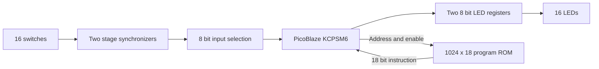

# Practical lecture

## PicoBlaze switch and LED control on Nexys4 DDR

Build a small processor-based system in **Vivado 2022.2**. Each of the 16 switches controls the LED with the same number. The design uses the real **KCPSM6 PicoBlaze processor** and a **1024 x 18-bit program ROM** implemented in one FPGA Block RAM. The completed design was programmed onto a Nexys4 DDR, and its operation was confirmed on the board.

### What you will learn

1. Describe the processor, program memory and input/output connections.
2. Write and assemble a PicoBlaze `.psm` program.
3. Generate the Verilog ROM from that program.
4. Create, simulate and implement a Vivado project.
5. Program the FPGA and test the result.

## 1 Prepare the files and tools

Use Windows, Vivado 2022.2 with Artix-7 device support, a Nexys4 DDR and a USB data cable. The FPGA part is `xc7a100tcsg324-1`.

Download the lecture folder, or clone the course repository. Work from a writable local folder, for example `C:/FPGA/Practical-lecture`. The examples below use that path; replace it with your actual folder.

| File | Purpose |
| --- | --- |
| `rtl/kcpsm6.v` | Original Xilinx processor implementation |
| `rtl/switch_led_top.v` | Connects the processor, ROM, switches and LEDs |
| `firmware/switch_led.psm` | Assembly source program |
| `firmware/kcpsm6.exe` | Xilinx KCPSM6 assembler for Windows |
| `firmware/ROM_form.v` | 7-series 1K ROM template used by the assembler |
| `firmware/switch_led.v` | Generated, initialized Verilog program ROM |
| `firmware/switch_led.hex` | Machine instructions in hexadecimal form |
| `constraints/nexys4_ddr.xdc` | Board pins and timing constraints |
| `sim/tb_switch_led.sv` | Automated simulation testbench |
| `tcl/create_project.tcl` | Creates the Vivado project |
| `tcl/build_and_test.tcl` | Simulates and builds the bitstream |

Keep the original copyright and license notices in the Xilinx files. They remain subject to their vendor terms.

## 2 Understand the hardware



The 100 MHz board oscillator clocks the whole system. PicoBlaze executes the instructions stored in the ROM. It reads switches through `in_port` and writes LED values through `out_port`.

A switch can change at any point relative to the clock. Registers `sw_meta` and `sw_sync` synchronize each input before the processor reads it. This does not debounce switches or make a multi-bit bus an atomic sample; neither is needed for displaying stable switch states.

PicoBlaze has 8-bit data ports. Therefore, the 16 inputs and outputs are split into two groups:

| Port ID | INPUT operation | OUTPUT operation |
| --- | --- | --- |
| `00` | Read SW0 through SW7 | Write LED0 through LED7 |
| `01` | Read SW8 through SW15 | Write LED8 through LED15 |

The same ID can name an input and an output because the instruction determines the direction. These are I/O port IDs, not ROM addresses.

The memory is internal FPGA Block RAM. The external DDR2 chip is unused. The processor also has 64 bytes of scratchpad data memory, which this program does not use.

## 3 Read the assembly program

Open `firmware/switch_led.psm`:

```asm
CONSTANT SW_LOW, 00
CONSTANT SW_HIGH, 01
CONSTANT LED_LOW, 00
CONSTANT LED_HIGH, 01
ADDRESS 000
loop: INPUT s0, SW_LOW
      OUTPUT s0, LED_LOW
      INPUT s1, SW_HIGH
      OUTPUT s1, LED_HIGH
      JUMP loop
```

`CONSTANT` gives readable names to hexadecimal port numbers. `ADDRESS 000` places the first instruction at the reset entry address. These are assembler directives and do not consume instruction locations. `loop` names that first instruction.

1. `INPUT s0, SW_LOW` copies the lower eight switch states into register `s0`.
2. `OUTPUT s0, LED_LOW` sends that byte to the lower LED register.
3. `INPUT s1, SW_HIGH` reads the upper eight switch states into `s1`.
4. `OUTPUT s1, LED_HIGH` updates the upper LEDs.
5. `JUMP loop` repeats the process continuously.

For example, SW0 and SW9 ON produce the bytes `01` and `02`, so LED0 and LED9 light. Multiple switch bits remain independent. Each instruction takes two clock cycles, giving a 10-cycle loop, or 100 ns at 100 MHz. The two groups update at different instants, with no visible difference to a person.

## 4 Generate the program memory from the PSM file

### 4.1 Place the assembler and template together

The `firmware` folder must contain:

```text
switch_led.psm
kcpsm6.exe
ROM_form.v
```

The supplied `ROM_form.v` is the Xilinx **7-series 1K** template, identified internally as `ROM_form_7S_1K_14March13.v`. It describes a `RAMB18E1` memory primitive and contains placeholders for the assembler to replace.

**Do not add `ROM_form.v` to Vivado as a design source.** It is a template, not compilable Verilog.

### 4.2 Run the assembler

Open PowerShell and run:

```powershell
cd 'C:/FPGA/Practical-lecture/firmware'
./kcpsm6.exe switch_led.psm
```

Use the firmware folder as the current directory so that the assembler finds `ROM_form.v`. The assembler reads the `.psm`, resolves labels and constants, encodes each instruction, and fills the ROM template.

### 4.3 Inspect the generated files

| Output | What to inspect |
| --- | --- |
| `switch_led.log` | Assembly listing, occupied addresses and any errors |
| `switch_led.hex` | Encoded 18-bit instruction words |
| `switch_led.v` | Ready-to-synthesize ROM with initialized contents |
| `switch_led.fmt` | Formatted assembly listing |

The verified instruction listing is:

| ROM address | Machine word | Instruction |
| --- | --- | --- |
| `000` | `09000` | `INPUT s0, 00` |
| `001` | `2D000` | `OUTPUT s0, 00` |
| `002` | `09101` | `INPUT s1, 01` |
| `003` | `2D101` | `OUTPUT s1, 01` |
| `004` | `22000` | `JUMP 000` |

Confirm that the log reports five occupied locations and last occupied address `004`. The supplied assembler uses a default 4096-word assembly address space; this can appear in the log and HEX output. The selected Verilog template physically implements **1024 words**, using address bits `[9:0]`. Keep this example within addresses `000` through `3FF`; a larger program requires a suitable larger ROM template.

### 4.4 Understand what the generated ROM contains

Open `switch_led.v`. Its module is named `switch_led`, matching the program basename. Its ports are:

```verilog
input  [11:0] address;
output [17:0] instruction;
input         enable;
input         clk;
```

The `RAMB18E1` initialization parameters hold the instruction bits, distributed between its data and parity initialization fields. The RAM primitive provides a synchronous instruction read. Write enables are disabled, so the memory behaves as ROM during normal execution.

The generated `.v` already contains the program contents. This design does **not** read `switch_led.hex` with `$readmemh`, and no Block Memory Generator IP or `.coe` file is required. The `.hex` file is useful for inspection; `switch_led.v` is the file Vivado builds.

```text
switch_led.psm + ROM_form.v
             |
        kcpsm6.exe
             |
        switch_led.v
             |
      Vivado synthesis and implementation
             |
      switch_led_top.bit
```

Changing only the `.psm` does not update the FPGA. After a firmware edit, assemble again, rebuild the bitstream, and program the board again.

## 5 Connect the ROM and processor

In `rtl/switch_led_top.v`, the processor produces `address` and `bram_enable`. The ROM returns `instruction`:

```verilog
switch_led program_rom (
    .address(address),
    .instruction(instruction),
    .enable(bram_enable),
    .clk(CLK100MHZ)
);
```

The input multiplexer selects `sw_sync[7:0]` or `sw_sync[15:8]` according to `port_id`. It is combinational, so the selected byte is available when PicoBlaze executes `INPUT`.

The LED registers change only when `write_strobe` is asserted. Port `00` writes the lower byte; port `01` writes the upper byte. The registers hold their previous values between writes.

`CPU_RESETN` is active low. The reset circuit asserts when the button is pressed and releases synchronously through four clocked stages. It also starts asserted after configuration. While reset is active, the LED registers are cleared. Interrupt and sleep inputs are tied low.

## 6 Create the Vivado project

### Script method

Open Vivado 2022.2. In the **Tcl Console**, run:

```tcl
source {C:/FPGA/Practical-lecture/tcl/create_project.tcl}
```

The script creates `vivado/switch_led.xpr`, selects `xc7a100tcsg324-1`, adds the sources and constraints, and selects the design and simulation top modules. It recreates the generated project, so keep your source edits in the lecture folders.

### Manual method

1. Select **Create Project** and choose an RTL project.
2. Select part **xc7a100tcsg324-1**. Board definition files are unnecessary.
3. Add these three design sources: `rtl/kcpsm6.v`, `rtl/switch_led_top.v`, and `firmware/switch_led.v`.
4. Add `constraints/nexys4_ddr.xdc` as the constraints file.
5. Add `sim/tb_switch_led.sv` as a simulation source.
6. Set `switch_led_top` as the design top and `tb_switch_led` as the simulation top.

Do not add the assembler executable, PSM source or ROM template as HDL sources.

## 7 Check the board constraints

The XDC maps `CLK100MHZ` to E3 and specifies a 10 ns clock period. It maps all switch and LED bits to the board pins and uses C12 for `CPU_RESETN`.

**SW8 and SW9 use LVCMOS18.** The remaining switch inputs and the LED outputs use LVCMOS33. Preserve these differences from the [official Digilent constraints](https://github.com/Digilent/digilent-xdc/blob/master/Nexys-4-DDR-Master.xdc).

Timing exceptions cover asynchronous switch inputs only up to their first synchronizer stage, the external reset input and the human-readable LED outputs. Internal processor and ROM paths remain timed against the 100 MHz clock.

## 8 Simulate the system

Choose **Run Simulation > Run Behavioral Simulation**, then **Run All**. Alternatively, enter `run all` in the simulator Tcl Console.

The testbench uses the real processor and generated ROM. It tests individual switches, inverted one-bit patterns, all-on and alternating patterns, 100 random combinations, and reset followed by restart.

Expected console message:

```text
PASS: individual switches, combinations, 100 random patterns and reset
```

Useful waveform signals are `sw`, `led`, `dut.address`, `dut.instruction`, `dut.port_id`, `dut.in_port`, `dut.out_port` and `dut.write_strobe`. The instruction address should repeatedly visit `000`, `001`, `002`, `003`, `004`.

The test allows 40 clock cycles after each switch change. This covers synchronization and repeated execution of the polling loop; it does not imply instantaneous LED updates.

## 9 Generate the bitstream

Run **Synthesis**, then **Implementation**, then **Generate Bitstream**. The GUI build produces:

```text
vivado/switch_led.runs/impl_1/switch_led_top.bit
```

To create the project, simulate and build in one operation, use:

```tcl
source {C:/FPGA/Practical-lecture/tcl/build_and_test.tcl}
```

The script also copies the bitstream to `output/switch_led_top.bit` and creates timing, utilization and DRC reports. Inspect the simulation result as well as the build completion message.

For the tested build, timing passed at 100 MHz with 0.704 ns setup slack and 0.073 ns hold slack. Resources were 116 LUTs, 130 registers and one RAMB18E1. DRC reported no errors and one `CFGBVS-1` warning about unspecified configuration-bank voltage properties; bitstream generation completed. The original core also produces legacy syntax and unused-logic warnings.

## 10 Program and test the board

1. Connect the USB cable to the board's **PROG/UART** connector and turn the board on.
2. Open **Hardware Manager > Open Target > Auto Connect**.
3. Select the `xc7a100t` device and choose **Program Device**.
4. Browse to `output/switch_led_top.bit`, or the GUI build path above, and click **Program**.
5. With all switches OFF, check that all 16 LEDs are off.
6. Set SW0 ON and check LED0. Repeat for each numbered switch.
7. Set several switches ON together and check the corresponding LEDs.
8. Hold **CPU RESET** to clear the LEDs. Release it to resume displaying switch states.

The supplied `tcl/program_board.tcl` offers the same programming operation for one connected Artix-7 target. The GUI method lets you explicitly select a board when several are connected.

Programming through JTAG is volatile. Reload the bitstream after removing power. Configuration flash programming is outside this exercise.

## 11 Troubleshooting

| Symptom | Check |
| --- | --- |
| Assembler cannot find the program or template | Run it from `firmware`; check the three required filenames |
| Syntax errors in `ROM_form.v` inside Vivado | Remove the template from design sources; add generated `switch_led.v` |
| Module `switch_led` cannot be found | Assemble the PSM and add its generated Verilog output |
| Firmware changes have no effect | Reassemble, rebuild, then program the new bitstream |
| No board appears | Check power, USB data cable, PROG/UART port and cable drivers |
| LEDs stay off | Release CPU RESET, check programming succeeded, and run the simulation |
| Wrong LEDs react | Check port names and bit indexes against the supplied XDC |
| Timing or pin errors after edits | Inspect implementation reports before programming |

## 12 Try a small extension

To display the inverse switch states, insert `XOR s0, FF` after the first INPUT and `XOR s1, FF` after the second INPUT. Reassemble and inspect the changed instruction listing, then rebuild and program. Now an OFF switch should light its LED. Update the testbench's expected values to match the new behavior, and restore the original program when finished.

The original five-instruction version has passed simulation, implementation and JTAG programming. Its switch-to-LED operation was confirmed by the board user on 12 November 2026.
