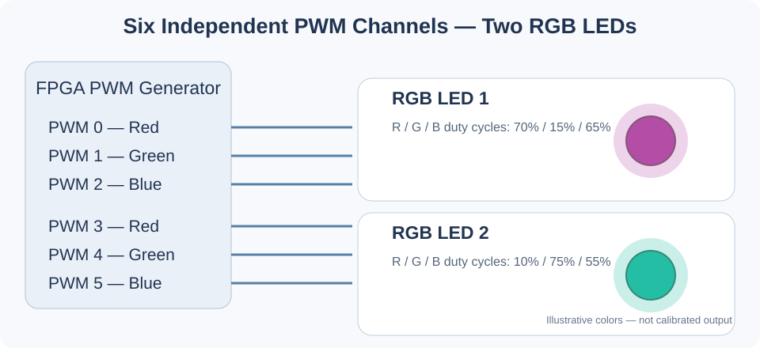

# Project 04 — Multichannel RGB LED Controller with PWM

[← Back to the project list](../README.md)

**Platform:** Nexys 4 DDR / Nexys A7-100T  
**Language:** VHDL or Verilog  
**Duration:** 4–5 weeks  
**Maximum grade:** **4/5**

## Project Description

Design an FPGA-based multichannel PWM controller for the **two onboard RGB LEDs** of the Nexys 4 DDR. Each RGB LED comprises red, green and blue components, so the implementation must generate **six independently configurable PWM outputs** in total. Students will control color and brightness using switches and push buttons, demonstrate independent RGB color mixing and implement automatic lighting effects. The focus is on visible real-time behavior on the board, rather than external measurement instruments. The existing PWM LED and Knight Rider laboratory modules may be reused or adapted.

## Hardware Illustration

*Conceptual view of the six independent PWM outputs controlling the two onboard RGB LEDs. The illustrated colors are examples, not calibrated measurements.*

## Minimum Implementation Requirements

1. Generate six independently controlled PWM outputs: R, G and B for each of the two onboard RGB LEDs.
2. Implement at least 8-bit PWM duty-cycle control for each component.
3. Select the target LED and color component, and adjust its intensity using onboard switches/buttons.
4. Display different colors simultaneously on the two RGB LEDs.
5. Implement **at least three automated lighting effects**, including (a) smooth color fading, (b) brightness pulsing and (c) alternating colors between the two LEDs.
6. Provide a user-selectable manual mode and automatic effects mode, with adjustable effect speed.
7. Demonstrate the completed modes directly on the FPGA board and explain the HDL architecture.

## Suggested HDL Modules

- Shared PWM timebase and six comparators.
- Six 8-bit duty-cycle registers.
- Input synchronizers and button debouncers.
- LED/channel selection and user interface FSM.
- RGB color transition engine with programmable interpolation steps.
- Lighting-effect FSM and effect-speed timer.

## Optional Extensions

- User-defined color presets stored in ROM.
- Gamma-adjusted brightness transitions.
- A third **external** RGB LED connected through a suitable Pmod interface (nine PWM channels total, with verified electrical compatibility).

## References and Source Projects

- [Course Lab 09 — PWM LED](../../Lab09/L9.1_PWM_LED/)
- [Course Lab 09 — Knight Rider PWM](../../Lab09/L9.3_Knight_Rider/)
- [Digilent Nexys 4 DDR GPIO demo](https://github.com/Digilent/Nexys-4-DDR-GPIO)
- [Nexys 4 DDR Reference Manual — Tri-Color LEDs](https://www.amd.com/content/dam/amd/en/documents/university/vivado-teaching/hdl-design/2015x/Nexys4DDR/Supporting%20Material/Nexys4DDR_rm.pdf)

**Hardware note:** The Nexys 4 DDR has **two**, not three, onboard RGB LEDs. The manufacturer's manual recommends PWM and cautions against sustained excessive brightness.

## Deliverables

HDL sources, XDC constraints, architecture diagram, a concise functional verification summary, Vivado resource report, and a practical FPGA demonstration showing independent colors and the automatic effects. No oscilloscope or external logic analyzer is required.

See the [general project guidelines](../README.md#general-project-guidelines) and [evaluation criteria](../README.md#evaluation-criteria).
