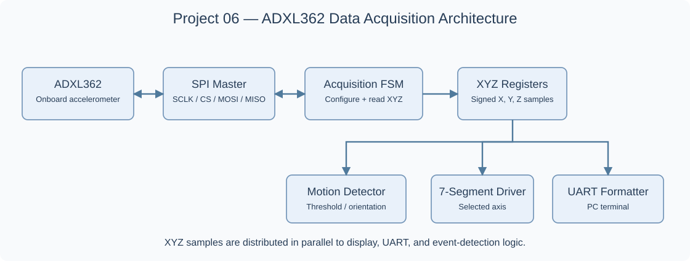

# Project 06 — SPI Interface for the ADXL362 Accelerometer

[← Back to the project list](../README.md)

**Platform:** Nexys 4 DDR / Nexys A7-100T  
**Language:** VHDL or Verilog  
**Duration:** 4–5 weeks  
**Maximum grade:** **5/5**

## Project Description

Design and implement an HDL-based SPI interface for the **onboard ADXL362 three-axis accelerometer** on the Nexys 4 DDR. The project builds on the sensor interfacing examples from the instructor's [L13.pdf](https://irh.inf.unideb.hu/~onigai/LDuHDL/2023/L13.pdf), which demonstrate SPI communication with a **PmodACL (ADXL345)** accelerometer and a **PmodGYRO (L3G4200D)** gyroscope. Students may study and reuse the laboratory's FSM-based approach to sensor register reading and writing, but they must adapt the communication protocol, register addresses, and initialization sequence to the **different ADXL362 sensor** actually fitted on the board.

The implemented system must periodically acquire acceleration measurements on all three axes, display selected values locally, transmit readings to a PC through UART, and detect at least one motion or orientation event. The emphasis is on the SPI controller, device initialization, data acquisition, processing and communication implemented in synthesizable HDL.

## Explanatory Figures

*Functional modules for ADXL362 configuration, XYZ acquisition, display, event detection and UART reporting.*

## Minimum Implementation Requirements

1. Implement an SPI master and an initialization/acquisition controller for the **ADXL362** using its documented commands and registers; do **not** reuse ADXL345 commands or register addresses without adaptation.
2. Periodically acquire **signed X, Y and Z acceleration samples**, and explain how the two-byte axis values are assembled.
3. Display a selected axis or measurement/status information on the onboard seven-segment display and/or LEDs.
4. Transmit all three acceleration measurements and relevant status information over **UART** to a PC terminal.
5. Implement a motion threshold or simple board-orientation detector, with a visible event indication.
6. Synchronize and debounce any board control inputs, and verify SPI timing and the controller FSM with suitable simulations.
7. Demonstrate the complete acquisition, display, UART output and event detection on the Nexys 4 DDR.

## Optional Extensions

- Configurable motion threshold and sampling interval.
- Basic averaging or digital low-pass filtering of acceleration samples.
- Peak acceleration or measurement statistics.
- Detection of activity/inactivity using ADXL362 capabilities and, optionally, its interrupt outputs where available on the board.
- VGA visualization of acceleration values or their evolution over time.

## Relationship to the Previous Laboratory

The [L13 course handout](https://irh.inf.unideb.hu/~onigai/LDuHDL/2023/L13.pdf) contains examples of an ADXL345 Pmod accelerometer and an L3G4200D Pmod gyroscope, including SPI read/write FSMs, register configuration and seven-segment display logic. Reproducing those examples unchanged is **not** sufficient for this project. The required contributions include **ADXL362 adaptation, three-axis periodic acquisition, UART data reporting, and motion/orientation detection**.

## Suggested HDL Modules

- Clock-enable / SPI timing generator.
- SPI master (serial shift registers and transaction FSM).
- ADXL362 initialization and register-access controller.
- Three-axis acquisition and sample registers.
- Signed data conversion and seven-segment display driver.
- UART transmitter and data formatter.
- Motion threshold or orientation logic.

## References and Source Projects

- [Instructor course handout — L13.pdf: Sensor Interfacing (PmodACL and PmodGYRO)](https://irh.inf.unideb.hu/~onigai/LDuHDL/2023/L13.pdf)
- [Analog Devices — ADXL362 Datasheet](https://www.analog.com/media/en/technical-documentation/data-sheets/adxl362.pdf)
- [Analog Devices — ADXL345 Datasheet (used by PmodACL in L13)](https://www.analog.com/media/en/technical-documentation/data-sheets/ADXL345.pdf)
- [Digilent — Nexys 4 DDR Out-of-Box Demo](https://github.com/Digilent/Nexys-4-DDR-OOB)
- [Digilent — Nexys4DdrUserDemo.vhd](https://github.com/Digilent/Nexys-4-DDR-OOB/blob/master/src/hdl/Nexys4DdrUserDemo.vhd)
- [Course Lab 08 — UART communication](../../Lab08/)

## Deliverables

HDL source code, FPGA constraints, architecture/block diagram, SPI/UART testbenches and simulation evidence, hardware demonstration, Vivado utilization and timing reports, and a brief explanation of the changes relative to the L13 laboratory implementations.

See the [general project guidelines](../README.md#general-project-guidelines), [recommended schedule](../README.md#recommended-project-schedule), and [evaluation criteria](../README.md#evaluation-criteria).
