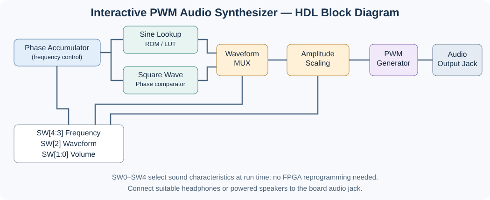

# Project 13 — PWM Audio Signal Processor

[← Back to the project list](../README.md)

**Platform:** Nexys 4 DDR / Nexys A7-100T  
**Language:** VHDL or Verilog  
**Duration:** 4–5 weeks  
**Maximum grade:** **5/5**

## Project Description

Build a small **interactive audio synthesizer** in VHDL or Verilog. The student must be able to change the sound **while the FPGA is running**, using the board's buttons and switches: choose between two waveform types, make the pitch higher or lower, and adjust the volume. Audio is generated digitally, converted to a PWM output by FPGA logic, and heard through an appropriate audio device connected to the board. Students may reuse the sine-wave generator and PWM audio output from Lab 09, but must add real-time waveform selection, frequency adjustment, and volume control.

## Functional Block Diagram

The switches configure frequency, waveform selection and amplitude dynamically; the audio output is heard using an external listening device.

## Proposed Switch Controls

| Switches | Function | Setting |
| --- | --- | --- |
| `SW0` | Waveform selection | `0` = sine; `1` = square |
| `SW[2:1]` | Volume (digital amplitude) | `00` = mute; `01` = 25%; `10` = 50%; `11` = 100% |
| `SW[4:3]` | Fundamental frequency | `00` = 220 Hz; `01` = 440 Hz; `10` = 660 Hz; `11` = 880 Hz |

The volume scaling is applied to signed samples (or relative to the midscale value for unsigned samples) **before** PWM generation. A shared phase accumulator or common frequency parameter is recommended for consistent pitch between waveform types. Students should verify that the switch positions change the actual audible output without rebuilding the FPGA bitstream.

## Required Equipment

- Nexys 4 DDR / Nexys A7-100T FPGA board and programming computer.
- **An external audio listening device**, such as suitable headphones or **powered (active) speakers**, connected to the board's audio output. The board does not have an integrated loudspeaker. Use the appropriate connector and safe output level; do not connect a passive loudspeaker directly to an FPGA pin.
- No oscilloscope or external logic analyzer is required.

## Minimum Implementation Requirements

1. **Selectable waveform:** Generate at least two audibly different waveforms, for example a sine wave (smooth tone) and a square wave (sharper tone). Use a switch or button to choose the waveform during operation.
2. **Pitch/frequency adjustment:** Use board controls to increase or decrease the audible frequency while the FPGA is running. Demonstrate at least several clearly distinct frequencies (220 Hz, 440 Hz, 660 Hz, and 880 Hz); the waveform must change pitch without rebuilding the bitstream.
3. **Volume/amplitude adjustment:** Use buttons or switches to select the four specified output levels (mute, 25%, 50%, and 100%). Implement this by adjusting digital sample amplitude **before** PWM generation.
4. **Audible output:** Route the digitally generated samples to the onboard PWM audio interface and demonstrate sound using connected headphones or powered speakers.
5. **Live demonstration:** Show waveform switching, pitch adjustment, volume adjustment, and mute in real time on the physical Nexys 4 DDR board. The effect must be audible and repeatable.
6. **HDL architecture:** Explain the waveform/sample generator, selection logic, frequency control, amplitude scaling, and PWM output modules. Provide a basic functional simulation of the timing-critical modules as supporting evidence; the principal assessment is the working hardware demonstration.

## Optional Extensions

- Mix two generated tones with independent frequencies and adjustable levels.
- Add simple audio effects such as echo, distortion, or digital filtering.
- Capture audio using the onboard PDM microphone and apply processing before playback.

**Scope:** This is a waveform synthesizer and audio processor, not a piano keyboard project. Piano-style note selection and recording/playback belong to Projects 15 and 16.

## References and Source Projects

- [Course Lab 09 PWM Audio](../../Lab09/L9.4_PWM_Audio/)
- [Digilent Nexys4 DDR GPIO demo](https://github.com/Digilent/Nexys-4-DDR-GPIO)
- [Digilent Out-of-Box audio demonstration](https://github.com/Digilent/Nexys-4-DDR-OOB)

## Deliverables

HDL source code, relevant constraints and testbench files, architectural block diagram, simulation evidence, working FPGA demonstration, resource utilization report, and a brief technical explanation of any reused reference design.

See the [general project guidelines](../../README.md#general-project-guidelines), [recommended schedule](../../README.md#recommended-project-schedule), and [evaluation criteria](../../README.md#evaluation-criteria).
